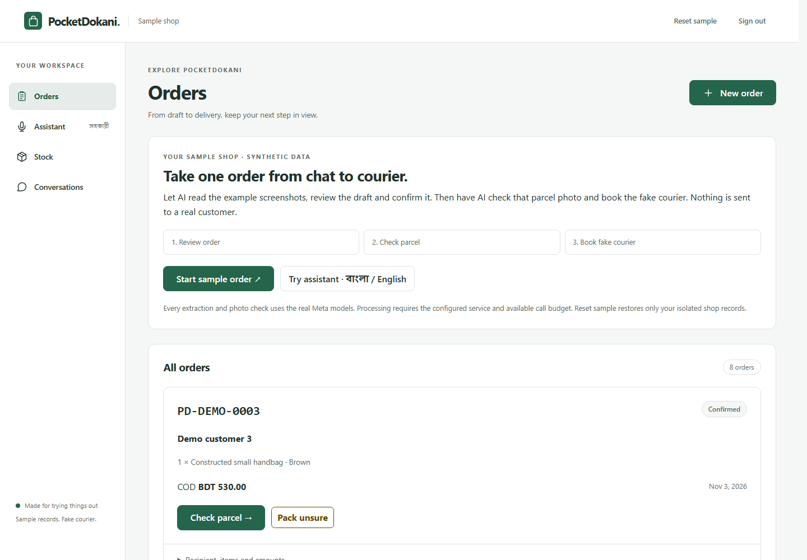

# PocketDokani

### Your shop. One less thing to juggle.

A Bangla AI copilot for small online sellers — from a customer's message to a ready-to-ship order.

Orders come from everywhere: WhatsApp, Instagram, TikTok, Messenger, even a phone call. PocketDokani brings the details, stock and delivery work together. AI prepares the work; the seller approves it.

**[Try the demo](https://pocketdokani.vercel.app/judge)** · [Seller sign-in](https://pocketdokani.vercel.app/) · [Setup guide](docs/setup.md)



## From conversation to courier

1. **Capture the order.** Upload conversation screenshots and an optional voice note, or enter a draft after a call. Muse Spark extracts the recipient, products and negotiated prices, with quotes linking back to the source.
2. **Review and confirm.** Correct the draft, choose the right SKU and verify any advance payment. PocketDokani calculates COD from the confirmed amounts.
3. **Check the parcel.** Photograph the label and visible bag. SAM locates regions; Spark reads the label without seeing the order. Code compares the reading with the confirmed details and shows mismatches or uncertainty.
4. **Book the courier.** Send the approved parcel to Steadfast. Invoice reconciliation protects against duplicate bookings after interrupted requests.

Or ask your shop directly: **“আজ কয়টা পার্সেল পাঠানো বাকি?”** Speak in Bangla or type a question. The assistant looks up business records, shows the supporting orders and proposes changes for you to confirm.

## Try it

Open the demo, choose **Start sample shop**, then **Start sample order**. The shop's products, orders and source images are synthetic; extraction, transcription, assistant answers and parcel analysis call the real Meta models. Results depend on the input and are never preloaded. Judge courier bookings are simulated, so exploring the demo never dispatches a parcel.

Review the extracted draft, confirm it, then upload a parcel photo for analysis. You can also download a synthetic parcel image to use as input. Missing model configuration or an exhausted call budget produces an error rather than a substitute answer.

## Powered by Meta

| Model | Its job |
| --- | --- |
| **Muse Spark 1.3** | Extract source-linked order drafts, read labels, compare visible products and choose business-record tools for the assistant. |
| **Muse Voice Transcribe** | Turn Bengali/English voice notes and assistant speech into editable text. |
| **SAM 3.1** | Locate shipping labels and handbags before visual analysis, with full-photo fallback when a usable region is absent. |

The Next.js app talks to FastAPI. Business rules calculate money, enforce shop isolation and gate changes behind seller confirmation. PostgreSQL stores records; private Supabase storage holds original images and model evidence.

## Run locally

Requires Python 3.12+, uv, Node 20.x ≥20.19 / 22.x ≥22.13 / ≥24, and ffmpeg for voice.

```sh
uv sync --frozen
npm ci
npm --prefix apps/web ci
npm run hooks:install
```

Copy `.env.example` to a new `.env`, set a random shop passcode and your Meta API key, and create `data/private/`. Then:

```sh
uv run alembic upgrade head
npm run dev:api
```

In another terminal, run `npm run dev:web` and open [localhost:3000/judge](http://localhost:3000/judge). Local development uses SQLite and private files. [Configuration, deployment and contributor commands →](docs/setup.md)

## Project layout

```text
apps/
  api/                  FastAPI, business rules, model/courier adapters, migrations
  web/src/
    app/                Next.js routes and global styles
    features/           Orders, conversations, assistant and workspace
    components/         Shared app shell and UI
    lib/                API client, formatting and pending-action storage
scripts/                COD, courier, privacy and source-partition checks
evals/                  Source-group manifest; private evaluation inputs stay ignored
docs/                   Setup, domain decisions and agent instructions
```

Screenshot import supports one-to-one mobile conversations with left/right bubbles; it does not connect directly to social-platform inboxes or record calls. A parcel photo checks visible details, not sealed contents. The seller remains responsible for confirming orders, payments and changes.

Built for the **Meta Global AI Developer Hackathon**. The seller's pre-existing spreadsheet was a private data source; the application and model integrations were built for the event.
