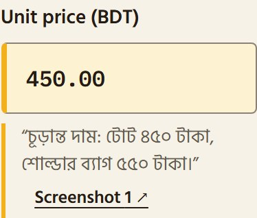
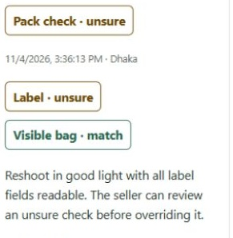
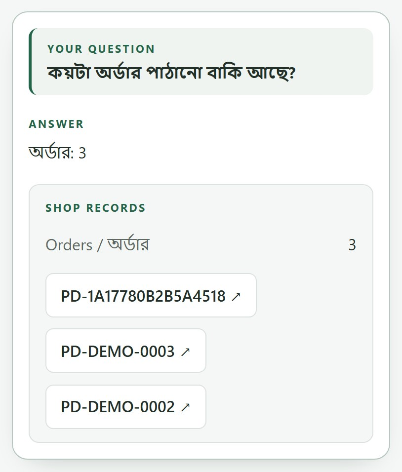

# PocketDokani

### Your shop. One less thing to juggle.

A small online bag shop in Bangladesh takes an order in chat, negotiates two prices, then copies the recipient and COD into a spreadsheet and a courier form. When someone else packs it, they have to ask again: which bag, which colour, what final price?

PocketDokani brings that work into a phone web app. It turns conversation screenshots into source-linked order drafts, checks visible parcel details, prepares courier bookings and answers business questions in Bangla. **AI prepares the work; the seller approves it.** In the constructed example below, the seller confirms two negotiated prices and BDT 80 delivery to produce COD BDT 1,080.

Built for the **Meta Global AI Developer Hackathon · Indie Developer · Build for Your World**. The application and model integrations were built during the event ([build history](https://github.com/afif-fahim/pocketdokani/commits)); the seller's pre-existing spreadsheet was a private data source.

**[Watch the demo video](https://youtu.be/gRwP7_oYYyM)** · **[Try the hosted sample shop](https://pocketdokani.vercel.app/judge)** · [Repository](https://github.com/afif-fahim/pocketdokani) · [Measured results](evals/results.md) · [Architecture](docs/architecture.md) · [Setup](docs/setup.md)

> **Hosted status, November 4:** one fresh `/judge` walkthrough on the deployed site completed with live model calls and no API errors: extraction, confirmation, a wrong-COD check (fail on the COD row), a matching-label check (pass), a fake booking, and a typed Bangla question answered from two order records. SAM fell back to the full photo on both checks; that run predates the SAM fix, which is not yet confirmed on the hosted site. Parcel photos were submitted by script, and the answer language stayed on English. A physical phone, camera capture and voice input were not exercised. This is one run, not an accuracy evaluation. The results below are from separate recorded runs.

## Try one order

The hosted judge entry needs no seller login or visitor API key. Its AI still needs the operator's configured Meta service, available credits and a finite call allowance. Every analysis calls real models; unavailable service or exhausted allowance produces an error.

1. Open the [demo](https://pocketdokani.vercel.app/judge), choose **Start sample shop**, then **Start sample order**.
2. Extract the sample screenshots. Inspect the source quotes, review the two item lines and recipient details, then save and confirm. A customer's payment claim does not count as verified prior payment.
3. Download a synthetic parcel image from **Check parcel**, upload it and analyze. Inspect the actual label/bag reasons. A fail requires correction and a new photo; an unsure result permits a separately recorded seller override after review.
4. Once packed, choose **Simulate booking · Fake**. Reload to inspect the order reference, COD and fake courier identifiers. Judge bookings never dispatch a parcel.
5. Open **Assistant**, select Bangla answers and type **“এখন কয়টা পার্সেল পাঠানো বাকি?”** Inspect the supporting order chips. Then ask to mark a booked sample order delivered using its actual reference; inspect the proposal before explicitly confirming it. Voice input offers an editable transcript before sending.

Each judge gets isolated synthetic records. Reset restores only that shop and preserves its model-call budget. Seller access is at [the main entry](https://pocketdokani.vercel.app/).

## What the app actually showed

These are captures of the working app after live Meta calls on **constructed local inputs**. The wrong-COD label failed and the matching label passed, one example of each; the Bangla question was typed. This separate landing walkthrough predates the SAM fix and is not the evaluation run summarized below. [Input provenance, exact captions and observations](apps/web/public/product/README.md).

| Inspect the agreed price | Catch a wrong COD before shipping | Ask in Bangla and inspect records |
| --- | --- | --- |
|  |  |  |
| The price retains its original screenshot quote. | Server code compares the blind reading with the order. | The count comes from the three cited orders. |

## Meta models at runtime

All three integrations call the **Meta Model API at [`https://api.meta.ai/v1`](https://api.meta.ai/v1)** through the [audited provider client](apps/api/pocketdokani/integrations/model_api.py). Spark's OpenAI-compatible chat format is a protocol choice; Meta supplies the runtime models.

| Model | Task and reason for using it | Implemented source |
| --- | --- | --- |
| `muse-spark-1.3` | Vision reads conversations and labels and compares visible bags with catalogue photos. Tool calling selects business lookups, proposals and metric references. | [Draft extraction](apps/api/pocketdokani/features/orders/drafting.py), [parcel vision](apps/api/pocketdokani/features/packing/pack_vision.py), [assistant loop](apps/api/pocketdokani/features/assistant/assistant.py) |
| `muse-voice-transcribe-1.0` | Turns voice notes or assistant speech into text, with Bengali/English language bias and shop vocabulary. Assistant input is editable before sending; order voice notes are stored extraction evidence. | [Audio normalization and transcription](apps/api/pocketdokani/integrations/voice_notes.py) |
| `sam-3.1` | Looks for label and handbag regions so Spark can inspect a crop, trying a second noun phrase before giving up. When no usable region exists, the pipeline records full-photo fallback. | [Segmentation and fallback](apps/api/pocketdokani/features/packing/pack_vision.py) |

## Design decisions

[Architecture](docs/architecture.md) has the request paths, isolation and failure handling. Four decisions keep model output reviewable:

- **Keep evidence beside the draft.** Extracted fields retain original-script source quotes and screenshot references. The seller corrects values and confirms amounts; customer text cannot verify a payment. [Extraction and confirmation](apps/api/pocketdokani/features/orders/drafting.py).
- **Read the label without the expected answer.** Spark reads the parcel label without seeing the order. Server code compares that reading with confirmed details. Unreadable fields remain unsure; only an unsure check permits a recorded override, and a fail cannot be overridden. This reduces confirmation bias but cannot recover an unreadable label. [Vision](apps/api/pocketdokani/features/packing/pack_vision.py), [comparison](apps/api/pocketdokani/features/packing/pack_comparison.py), [authorization](apps/api/pocketdokani/features/packing/pack_checks.py).
- **Render validated numbers from records.** Spark selects tools and metric references; server code validates the references and renders stored-record values in the chosen language. Proposed writes use the ordinary confirmation paths. These controls reduce unsupported answers; tool selection can still be wrong. [Assistant](apps/api/pocketdokani/features/assistant/assistant.py), [tools](apps/api/pocketdokani/features/assistant/assistant_tools.py).
- **Reconcile before retrying a courier request.** A durable attempt records the order reference as invoice before calling the courier. Interrupted or uncertain outcomes keep stock reserved and require an invoice lookup before retry. Fake and live paths remain distinct. [Booking workflow](apps/api/pocketdokani/features/courier/bookings.py).

## Measured results and limits

[**`evals/results.md` is the single results record**](evals/results.md), including denominators, failed cases and limits. On November 5, a local run used real models with one real seller chat, the real seller workbook (both kept private) and 19 constructed parcel checks. Bugs were fixed during the run, so these are development results, not a held-out benchmark.

| Check | Observed outcome | Sample / limit |
| --- | --- | --- |
| Real chat extraction | 8/8 fields on 3/3 repeats | One conversation, checked against the workbook; quantity and discount, not stated in the chat, were left for the seller |
| Business questions | 20/20 correct; 0 confidently wrong | Real workbook; Bangla, Banglish and English, including 3 correct unknown responses |
| Wrong labels / wrong bags | 7/7 and 3/3 caught | Constructed labels, some beside real catalogue photos; no real handwritten label |
| Clean parcels / unclear labels | 5/6 passed; 3/3 unsure | The clean miss returned unsure, not fail |
| SAM localization | 19/19 checks cropped both regions | Crop 10/11 against full photo 11/11 on the same parcels: no accuracy gain here, and slower |
| Real Bangla voice note | Accuracy not verified | One 4 s clip gave the same meaning on 6/6 calls; not yet checked against the audio by a person |

**No genuine pilot shipment or time-saved measurement is claimed.** A live courier adapter is implemented; that alone is not evidence of a real shipment.

Courier fee records are absent, so **payout due cannot currently be derived**. A parcel photo checks visible details and reveals nothing about sealed contents. Handwriting, real parcels, Bangla speech quality and more than one real chat remain unevaluated in this record. These controls do not establish perfect model accuracy.

## Run locally

Needs Python 3.12+, uv, Node 20.19+/22.13+/24+, ffmpeg (voice) and your own Meta API key with credits. Without a key, browsing and manual drafts work; analysis returns an error.

```sh
uv sync --frozen && npm ci && npm --prefix apps/web ci
uv run --frozen alembic upgrade head
npm run dev:api   # then, in another terminal: npm run dev:web
```

Open [localhost:3000/judge](http://localhost:3000/judge). Full env config, deployment and troubleshooting: [docs/setup.md](docs/setup.md).

Screenshot import supports one-to-one mobile conversations with left/right bubbles. It does not connect directly to social-platform inboxes or record phone calls. The seller remains responsible for confirming orders, payments and changes.
