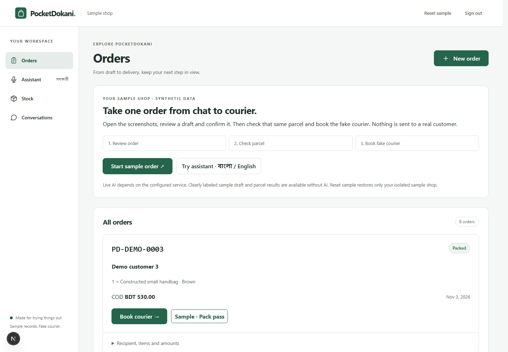

# PocketDokani

A Bangla AI copilot that helps small Messenger sellers turn chat screenshots into orders, check packed parcels and book the courier, with the seller approving every change.

## Try the demo

Open the [sample shop](https://pocketdokani.vercel.app/judge), then choose **Start sample shop**. No passcode or sign-up is needed. The [seller workspace](https://pocketdokani.vercel.app/) requires a shop passcode.

1. Choose **Start sample order**, then **Use sample draft · no AI analysis**. Review the source chips, items and amounts; **Confirm order** keeps the same order reference through the next steps.
2. Under **Check parcel**, choose **Wrong label COD · fail**, then **Use sample result · no AI analysis**. Select **Corrected parcel · pass** and apply another sample result, then choose **Simulate booking · Fake**. No parcel is dispatched.
3. Open **Assistant** to ask about pending dispatch, stock or recorded sales. Choose English, Bangla or Automatic; speech is transcribed into editable text before sending. Live assistant, extraction and photo analysis need enabled server models and available call budget.

Each visitor gets isolated synthetic records. **Reset sample** resets only that session. Sample drafts and parcel results are hand-authored demonstrations, explicitly labeled **no AI analysis**; live requests never silently substitute them. Courier bookings in judge mode always use the fake adapter. These instructions describe the current source; hosted acceptance of this workflow remains open in the [evidence record](docs/verification.md).

Three-minute video: not published yet; recording and the final link belong to the [submission checklist](https://github.com/afif-fahim/pocketdokani/issues/7).



## What works in the source

- **Chat → order:** ordered screenshots and optional voice notes become editable multi-item drafts with source quotes and SKU suggestions. The seller verifies payments and confirms the COD amount.
- **Pack check:** read the visible label without showing the model the order, then compare in code. A mismatch blocks booking; an unsure result permits a separately recorded seller override. Visible-bag checks cannot establish sealed contents.
- **Courier:** book a packed order with Steadfast, reconcile uncertain responses by invoice and deduct stock once. Judge bookings are simulated; production seller booking requires an explicit flag and server keys.
- **Business assistant:** voice or typed questions call shop-scoped record tools. The app renders cited metrics from stored results; suggested drafts, bookings and status changes require confirmation. Orders, stock and payouts can also be inspected directly.

## Where Meta models fit

| Model | Implemented role |
| --- | --- |
| Muse Spark `muse-spark-1.3` | Screenshot extraction and SKU suggestions; blind label reading and visible-bag comparison; assistant tool selection and metric references. Code validates drafts, compares labels and renders numeric answers. |
| Muse Voice Transcribe `muse-voice-transcribe-1.0` | Bengali/English transcription for order voice notes and assistant speech, after server-side audio normalization with ffmpeg. |
| SAM `sam-3.1` | Optional shipping-label and handbag regions before Spark analysis. Missing regions fall back to the full photo; users can also compare the full-photo method. |

Model calls are off by default. Manual orders, record browsing and the explicit sample order/parcel workflow work without AI; assistant answers and real extraction/transcription/photo analysis do not.

## Run locally

Requires Python 3.12+, uv, and Node 20.x ≥20.19, 22.x ≥22.13 or ≥24. In a clean checkout:

```sh
uv sync --frozen
npm ci
npm --prefix web ci
npm run hooks:install
```

Copy `.env.example` to a new `.env`, set a random `SHOP_PASSCODE` of at least 12 characters, and create `data/private/`. Then run:

```sh
uv run alembic upgrade head
uv run uvicorn pocketdokani.main:app --host 127.0.0.1 --port 8000 --no-access-log
```

In another terminal, run `npm --prefix web run dev` and open [localhost:3000/judge](http://localhost:3000/judge). The default uses SQLite and private local files. See the canonical [development guide](docs/development.md) for configuration, optional live models, imports and workflow checks, and the [deployment runbook](docs/deployment.md) for Vercel, Render and Supabase.

## Architecture and source map

The Next.js phone UI proxies `/api/*` to FastAPI. FastAPI owns authentication, shop-scoped records, Meta calls and the live/fake courier adapters. Hosted records use PostgreSQL and private Supabase objects; originals are served only after authorization.

| Path | Responsibility |
| --- | --- |
| `web/app/` | App shell, draft editor, assistant, parcel check and courier controls |
| `api/pocketdokani/` | API endpoints, business rules, model/courier adapters and synthetic fixtures |
| `api/migrations/` | Versioned database migrations |
| `scripts/` | COD/booking checks, source partitions and staged-data privacy guard |
| `evals/` | [Development/evaluation source grouping](evals/README.md), without private inputs |
| `docs/` | Setup, deployment and [verification evidence](docs/verification.md); [domain vocabulary](GLOSSARY.md) and [decisions](docs/adr/) explain invariants |

## Evidence and limits

Local browser checks cover the synthetic order → parcel → fake-booking flow. A hosted rehearsal returned live extraction and a Bangla assistant answer; a synthetic parcel illustration returned **unsure**. These establish exercised paths, not accuracy. Development pack checks covered 14 generated scenes: both methods agreed on all 14, but SAM found no label regions. [Results, dates, environments and historical evidence](docs/verification.md) retain the caveats.

No held-out accuracy scores or measured pilot results are published. Physical-phone camera/microphone behavior, a genuine-order courier workflow and the polished hosted workflow still need acceptance. Automatic courier status sync and reliable net payout-due calculation are outside the implemented scope.

## Hackathon and release

Built for the Meta Global AI Developer Hackathon. The pre-existing seller spreadsheet is a private data source; the application and model integrations were built for the event. The [submission/release checklist](https://github.com/afif-fahim/pocketdokani/issues/7) owns evaluation, video, the owner's license choice and public-repository release. No license is selected in this checkout.

Contributors and coding agents start with [AGENTS.md](AGENTS.md). Private business documents, credentials and customer media stay ignored; committed fixtures and demo assets use synthetic or anonymised data.
