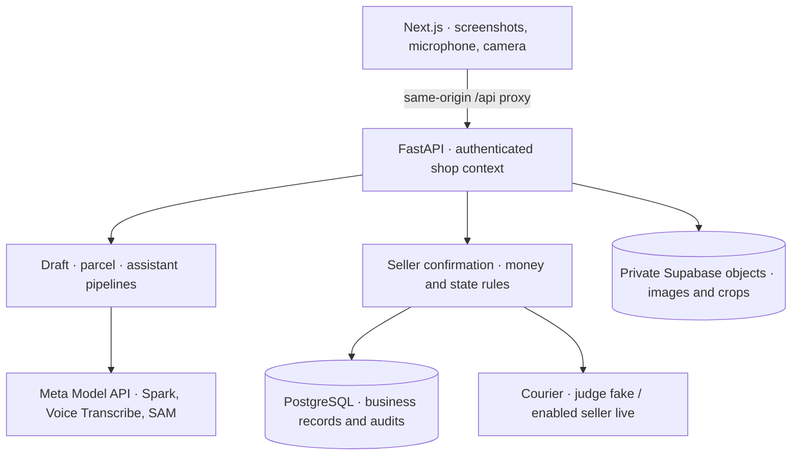

# Architecture

PocketDokani is a Next.js phone web app backed by FastAPI. The models prepare readings, drafts and tool selections; server code owns money, order state and writes. [Setup](setup.md) is the canonical configuration and deployment guide. [GLOSSARY.md](../GLOSSARY.md) defines the business terms.



The [Next.js rewrite](../apps/web/next.config.ts) forwards browser API requests to [FastAPI routes](../apps/api/pocketdokani/main.py). The API alone holds provider credentials and accesses the database and object store. Production requires PostgreSQL and private Supabase storage; local development supports SQLite and local files. [Records](../apps/api/pocketdokani/data/records.py) store orders, line prices, stock, payouts, workspaces, pack checks, sessions and model runs; [object storage](../apps/api/pocketdokani/data/storage.py) holds original screenshots, catalogue images and parcel evidence.

## Conversation to confirmed order

The seller uploads an ordered screenshot batch, identifies the seller's side and can add a voice note. [Voice transcription](../apps/api/pocketdokani/integrations/voice_notes.py) normalizes audio with ffmpeg, then calls `muse-voice-transcribe-1.0` with Bengali/English language bias and shop vocabulary. The stored transcript becomes extraction evidence.

[Extraction](../apps/api/pocketdokani/features/orders/drafting.py) sends screenshots, transcripts and available catalogue SKUs/photos to `muse-spark-1.3`. Each extracted field carries a quote plus a screenshot index or voice-note reference. Server validation rejects unsupported values and leaves fields needing review empty; a source link still needs the seller's inspection, since the server does not independently read screenshot text.

The seller reviews lines, prices, recipient details and any verified prior payment before confirming. [Decimal money rules](../apps/api/pocketdokani/features/orders/money.py) calculate:

```text
COD = sum(quantity × unit price − line discount)
      + customer delivery charge − verified prior payment
```

Negative COD is rejected. Customer payment claims cannot establish verified payment. Bundle allocation follows [ADR 0002](adr/0002-use-line-pricing-for-bundles.md). Editing a confirmed or packed order returns it to a draft and clears its active pack check; revision checks reject stale writes.

## Parcel photo to packing decision

[Parcel vision](../apps/api/pocketdokani/features/packing/pack_vision.py) calls `sam-3.1` separately for the label and handbag regions, trying a second noun phrase when the first finds nothing. Unusable or ambiguous geometry falls back to the full photo; the seller can also request full-photo analysis without SAM. A label read with no legible field is re-read once on the full photo. Provider failure remains an error.

Spark reads the label in a **blind call**, without the expected order. A separate call compares visible bags against the order's SKU photographs. [Deterministic comparison](../apps/api/pocketdokani/features/packing/pack_comparison.py) then checks the label reading against the stored label order number, phone, COD, name and address. Historical label numbers remain distinct from courier identifiers, as defined in [ADR 0001](adr/0001-order-references-independent-of-couriers.md).

[Pack-check rules](../apps/api/pocketdokani/features/packing/pack_checks.py) combine the label and bag verdicts. A pass marks the order packed; a fail requires correction and another photo. Only a current **unsure** check permits a recorded seller override, displayed separately from a pass. Original photos, available crops, readings and reasons remain private evidence. These controls reduce confirmation bias and expose uncertainty; they do not establish perfect reading accuracy or reveal sealed contents.

## Grounded assistant and approved changes

Speech is transcribed into an editable question before the seller sends it. The [assistant loop](../apps/api/pocketdokani/features/assistant/assistant.py) lets Spark select from [closed, shop-scoped tools](../apps/api/pocketdokani/features/assistant/assistant_tools.py), with a maximum of six tool calls. Read tools retrieve orders, stock, products, sales totals and recorded payouts.

Spark's final output selects citation and metric references, not prose or numeric values. The server validates those references and renders the stored or calculated metrics with English/Bangla labels; the UI exposes supporting record chips. This prevents model-written arithmetic from becoming the displayed business total, while tool selection can still be wrong. Courier fees are not stored, so **payout due is unknown**; delivered COD and recorded payouts are distinct metrics.

Proposal tools suggest a draft, booking or status change without changing business records. The [proposal UI](../apps/web/src/features/assistant/assistant.tsx) requires a confirmation tap and calls the same [order actions](../apps/api/pocketdokani/features/orders/order_actions.py) and booking routes as the normal UI. Creating a draft still requires a separate review and order confirmation. Expected versions/statuses protect against approving stale proposals.

## Courier recovery and stock

[Booking](../apps/api/pocketdokani/features/courier/bookings.py) requires a current packing pass or seller override. Before contacting the courier, it commits a durable attempt, order snapshot and stock reservation. The stable PocketDokani order reference is the invoice; the consignment ID and tracking code are separate results.

A timeout leaves an unknown outcome and preserves the stock hold. **Check courier booking** looks up that invoice before creation can be retried. Duplicate responses trigger invoice lookup; a confirmed consignment deducts stock once. A recorded return/cancellation of a booked order restores stock and requires the parcel physically back with the seller; it does not cancel a shipment at Steadfast.

The [courier adapters](../apps/api/pocketdokani/features/courier/courier.py) separate simulated and live requests. Judges always use the fake courier. Development sellers use fake booking unless live is enabled; production seller booking is disabled until the server flag and credentials enable it. An implemented live adapter is not evidence of a genuine pilot shipment.

## Session boundaries and model evidence

[Session authentication](../apps/api/pocketdokani/core/security.py) uses separate HttpOnly seller/judge cookies and server-side sessions. Seller sessions share the single seller shop; every judge session receives a separate random owner and synthetic shop. Queries and object-serving routes check that owner/context. The model cannot supply a different owner to a tool. Judge reset affects that judge's records and retains its model-call budget.

All runtime model requests use the [Meta Model API adapter](../apps/api/pocketdokani/integrations/model_api.py) at `https://api.meta.ai/v1`. Each provider attempt, including retries, consumes a shop-scoped budget and records the model, input references, output, usage and latency in private `model_runs`; assistant turns additionally retain tool events. Provider error bodies are not saved. Missing configuration, provider errors or exhausted budgets produce an error or an explicitly incomplete assistant turn with any completed record lookups preserved; they never substitute preloaded analysis. See [setup and smoke checks](setup.md#smoke-checks-and-operations) for operational limits and credential-dependent verification.
